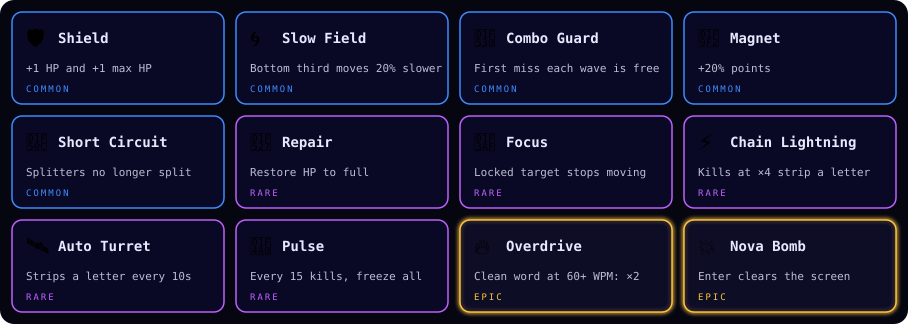

<p align="center">
  
</p>

<p align="center">
  <a href="#run-locally"></a>
  
  
  
  
  <a href="LICENSE"></a>
</p>

<p align="center">
  Words fall toward your ship as enemies. <b>Type a word to lock on and fire.</b><br>
  Clear a wave, pick one of three upgrades, and see how many waves you can survive.<br>
  Every fifth wave brings a boss that fires missiles.
</p>

---

##  How to play

- Type the first letter of any enemy's word to lock on to it, then finish the word to destroy it.
- An enemy that reaches your ship costs hit points. The ring around the ship shows what you have left.
- After each wave, pick one of three upgrades (`1` `2` `3`, or tap a card).
- Combo grows with words typed in a row: ×2 after 2, ×4 after 4, ×8 after 8. Any miss resets it.

On a phone, tapping Start opens the keyboard. A pause button sits in the top corner.

| Screen | Key | Action |
|--------|-----|--------|
| Menu | `Enter` | Start a run |
| Playing | `Esc` | Pause |
| Playing | `Backspace` | Release the lock |
| Playing | `Enter` | Fire Nova (when you have it) |
| Paused | `Esc` / `Enter` | Resume |
| Paused / Game over | `R` | Back to menu |
| Game over | `Enter` | New run |

##  Enemies

| | Enemy | What it does |
|:-:|-------|--------------|
|  | **Drone** | Flies straight at your ship. The most common enemy. |
|  | **Seeker** | Curves toward your ship, leaving a light trail. |
|  | **Splitter** | Splits into two drones with short words when destroyed. |
|  | **Armored** | Slow, with long words. A hit costs two hit points. |

##  Boss waves

Every 5th wave is a boss. Type its words to wear down its health bar, and shoot its one-letter missiles  before they hit.

## Upgrades

Twelve upgrades in three rarities: <b>common</b>, <b>rare</b> and <b>epic</b>. Each cleared wave offers three.

<p align="center">
  
</p>

## Features

- Endless waves with a rising difficulty curve, four enemy types and boss waves
- English and Arabic word sets, with a fully mirrored interface in Arabic
- Four colour themes, eight achievements, a local leaderboard and a shareable result card
- Generated sound effects and a layered music loop, with separate volume controls
- Plain HTML, CSS and JavaScript modules. No build step, no dependencies, no asset files: graphics, sound and music are all generated in code

## Play

Live on Vercel: deploys automatically from `master`. Works on desktop and on phones, in English and Arabic.

## Run locally

Any static file server works. With Python:

```bash
python3 -m http.server 3737
```

Then open `http://localhost:3737/`.

## Tests

Requires Node 18+ (no install step):

```bash
node --test 'tests/*.test.js'
```

## License

[MIT](LICENSE) © 2026 Mo
